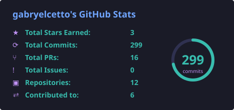
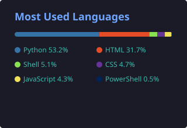

**Suporte/Desenvolvimento Jr.** · Estudante de Análise e Desenvolvimento de Sistemas

Estudante de ADS (3º período) que já atua profissionalmente com desenvolvimento e suporte. No dia a dia, participo da construção e da manutenção de sistemas, crio automações em Python e resolvo problemas técnicos reais, buscando sempre soluções organizadas e fáceis de manter.

## Experiência

Atuação profissional em **Suporte/Desenvolvimento Jr.**, participando do desenvolvimento e da manutenção de sistemas, automações, tratamento de problemas técnicos, levantamento de requisitos e implementação de melhorias.

Também participo de reuniões com usuários e equipe para compreender necessidades, levantar requisitos e transformar essas necessidades em soluções técnicas.

> Os projetos profissionais não aparecem aqui por serem privados e de propriedade da empresa.

## Tecnologias

| Área | Tecnologias |
| :--- | :--- |
| **Linguagens** |    |
| **Web** |    |
| **Banco de Dados** |   |
| **Versionamento** |   |
| **DevOps & CI/CD** |     |
| **Automação** |  |
| **Monitoramento** |   |
| **Metodologias** |   |

## GitHub Stats

  
  

